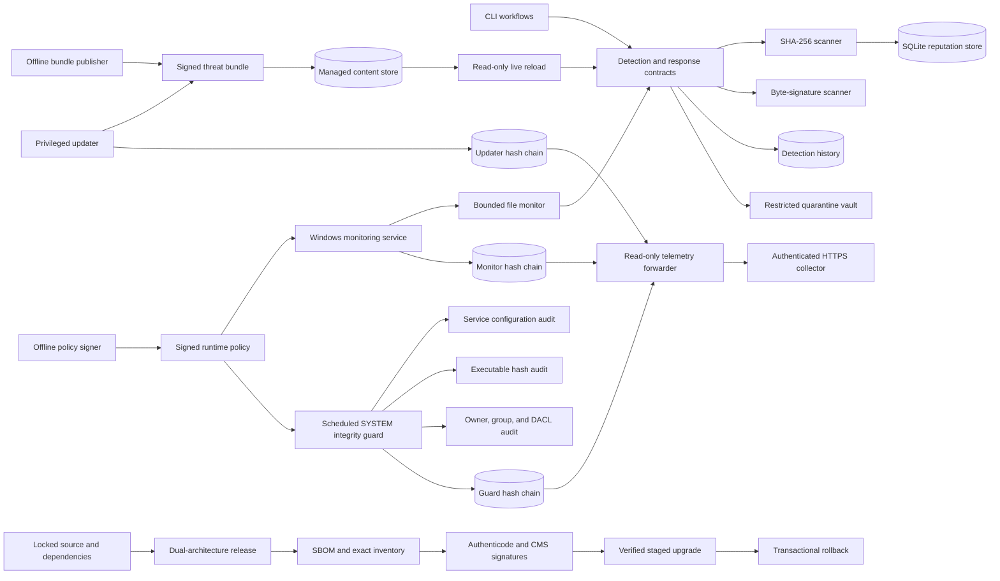

# UtoAegis

**A proprietary .NET 10 Windows endpoint-security engineering project by Francisco Jaimes**

UtoAegis is an incrementally developed endpoint-security platform focused on
defensive design, explicit trust boundaries, safe file handling, authenticated
threat intelligence, and operationally visible failure modes.

This repository is a portfolio showcase. It contains project documentation only;
the implementation is maintained in private repositories.

## What the project demonstrates

- Streaming SHA-256 file identification without executing scanned files
- Local malicious-hash reputation backed by a versioned SQLite schema
- Bounded exact-byte signature detection across streaming buffer boundaries
- Recursive directory scanning with concurrency, traversal, and reparse-point limits
- Correlated JSON Lines telemetry and transactional detection history
- Debounced real-time monitoring with overflow recovery
- Detection-gated quarantine and integrity-verified restoration
- A supervised Windows Service with an observe-only default
- Signed ECDSA P-256 threat-intelligence bundles with anti-rollback state
- A separately privileged HTTPS updater with retention and rollout telemetry
- Atomic live detector replacement with last-known-good fallback and generation leases
- Bounded tamper-evident event chains with authenticated HTTPS forwarding
- Signed dual-architecture releases with SBOMs and transactional rollback
- Offline-signed runtime response policy with exact-byte verification and anti-rollback
- A separate SYSTEM integrity guard for service, executable, and ACL drift
- Explicitly authorized, rate-limited recovery with independent tamper telemetry

## Architecture

The monitoring service remains read-only toward managed threat content. The
updater is the only component granted content-store write access, while private
signing keys stay off endpoints. Runtime policy is separately signed and
anti-rollback protected, so local configuration alone cannot silently authorize
a stronger response. The scheduled guard independently audits Windows Service
Control Manager settings, executable identity, and protected path ownership and
DACLs. Recovery requires both signed-policy authorization and an installer
opt-in, remains rate limited, and never recreates missing objects or replaces a
modified executable. Monitor, updater, and guard telemetry spools remain
separate; only the forwarder can read the collector credential and use the
telemetry network boundary. Release verification independently binds every
packaged file, the software bill of materials, and owned binaries before a
staged service upgrade can change Service Control Manager paths.

## Milestone progression

| Milestone | Capability |
| --- | --- |
| 1 | File hash scanner |
| 2 | Malware hash reputation database |
| 3 | Streaming signature scanner |
| 4 | Bounded directory scanner |
| 5 | Detection history and structured logging |
| 6 | Real-time file monitoring |
| 7 | Safe quarantine and recovery |
| 8 | Supervised Windows monitoring service |
| 9 | Authenticated threat-intelligence updates |
| 10 | Production threat-intelligence updater |
| 11 | Live threat-intelligence reloading |
| 11.1 | Read-only reload polling correction |
| 12 | Tamper-evident security telemetry |
| 13 | Signed releases and deployment hardening |
| 14 | Authenticated runtime policy and integrity guard |

## Security-engineering highlights

- Files are scanned without execution.
- Results distinguish detection, no match, unknown reputation, and operational failure.
- Directory traversal rejects unsafe reparse-point behavior and enforces explicit bounds.
- Quarantine requires detector evidence and revalidates file identity before removal.
- Threat bundles bind exact manifest bytes, hashes, lengths, versions, and validity windows.
- Monotonic sequence state prevents replay of older signed content.
- Candidate detector generations are completely validated before atomic publication.
- Invalid updates preserve the last-known-good in-memory generation.
- Monitoring, updating, guarding, and telemetry forwarding use separate least-privilege identities.
- Telemetry chains expose modification, reordering, stale checkpoints, and retention gaps.
- Collector checkpoints advance only after an exact sequence-and-hash acknowledgement.
- Release manifests reject missing, extra, modified, traversing, or reparse-point content.
- Production bundles require approved CMS and Authenticode signing evidence.
- Multi-service upgrades restore prior paths and running states on failure.
- Runtime policy anti-rollback binds each sequence to one exact manifest hash.
- The guard audits exact service command lines, accounts, start modes, executable hashes, and normalized ACL state.
- Automatic repair requires dual authorization, excludes password-backed service identities, and uses a persistent recovery budget.

## Verification snapshot

The Milestone 14 baseline was verified with:

- .NET 10 Release build with zero warnings and zero errors
- 290 passing automated tests across 14 projects
- Locked dependency restoration with one lock file per project
- Direct and transitive NuGet vulnerability auditing
- Formatter verification
- Three passing PowerShell release, deployment, and runtime-policy integration suites
- PowerShell parser validation for all 30 automation and deployment scripts
- CycloneDX 1.7 schema validation for the 37-component release SBOM
- Verified locked publishing for `win-x64` and `win-arm64`
- Verified 197-file manifest inventory in each extracted development archive with SHA-256 checksums
- A clean unfinished-work marker scan and a concise-comment audit

This is an engineering portfolio project, not a claim of independent antivirus
certification or guaranteed detection of every malicious file.

## Technology

C#, .NET 10, SQLite, MSTest, Windows Services, Windows Service Control Manager
APIs, Windows Task Scheduler, PowerShell, GitHub Actions, ECDSA P-256, SHA-256,
HMAC-SHA256, Authenticode, CMS/PKCS #7, CycloneDX 1.7, JSON Lines, and Windows
filesystem security controls.

## Ownership

Copyright © 2026 Francisco Jaimes. All rights reserved.

UtoAegis is proprietary software. The source implementation is not licensed for
copying, modification, redistribution, or third-party commercial use. This
showcase does not distribute the source code or grant implementation rights.

## Contact

- [GitHub profile](https://github.com/Utopias187)
- [LinkedIn](https://www.linkedin.com/in/frjaimes/)
